<div align="center">


# Matrix Finder

### Files, data and a terminal, side by side.

**Look inside. Stay in flow.**

Browse folders, archives and servers, and see what a Parquet table, an HDF5 file or a<br>
model checkpoint holds without opening Python. A terminal sits next to your files.

[](https://www.rust-lang.org)
[](#install)
[](#license)
[](#privacy-and-security)

[**Data**](#working-with-data) ·
[**Code**](#working-with-code) ·
[**Settings**](#settings-for-developers) ·
[**Formats**](#formats) ·
[**Screenshots**](#screenshots) ·
[**Install**](#install) ·
[**Shortcuts**](#shortcuts)

<br>

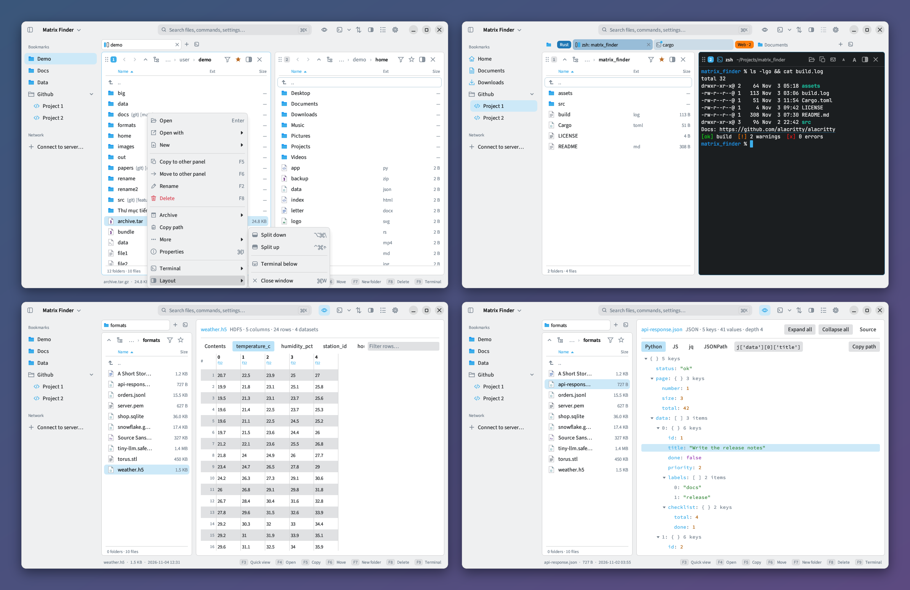

<sub>Git folders with their branch · a terminal beside the files · an HDF5 dataset · a JSON value and its path</sub>

<br>

**Install:** the [macOS DMG](https://github.com/quangtiencs/matrix_finder/releases/latest) (Apple silicon), the [.deb and .rpm packages](https://github.com/quangtiencs/matrix_finder/releases/latest) (Ubuntu, Debian, Fedora), or the script on macOS and Linux ([details](#install)):

```bash
curl -fsSL https://raw.githubusercontent.com/quangtiencs/matrix_finder/main/scripts/install.sh | bash
```

</div>

---

Press <kbd>F3</kbd> and the panel on the right shows the file under the cursor: the rows of a table, the variables of a dataset, the tensors of a model, a rendered notebook. Move the cursor and it follows. Large data and model files are read only as far as needed (usually just the header), so a checkpoint of several gigabytes shows up as quickly as a small one.

## Working with data

- **Check a dataset before loading it.** Parquet, Arrow, Avro, ORC, CSV, Excel and JSON Lines open as a table of the first 1,000 rows with column types and the row count. Type in *Filter rows* to find a value.
- **See what is in a scientific file.** NumPy, HDF5, MATLAB, NetCDF, R, Stata, SPSS and SAS files list their arrays or variables with shapes, types and labels; small arrays show as tables.
- **Look into a model.** safetensors, GGUF, PyTorch and ONNX files list every tensor with its shape, dtype and size, and the parameter count. PyTorch's pickle is read as data, never run.
- **Read notebooks and query results in place.** Jupyter notebooks are rendered; SQLite and DuckDB show their tables and columns; JSON opens as a tree, and a click gives the path of a value to copy as `j['data'][0]['name']` (or for JavaScript, jq, JSONPath).
- **Find files by what they are.** `ext IN ('pt', 'safetensors') AND size > 1GB`, `age < 7d`, globs and regular expressions filter a folder as you type, or search every subfolder.

## Working with code

- **A terminal next to the files**, in the same tab: split a tab into up to four file and terminal windows from the toolbar's split button or a key. Full-screen programs work, including Claude Code (<kbd>Shift</kbd>+<kbd>Enter</kbd>, mouse clicks), Vim and htop. A button starts Claude Code, Codex, Gemini CLI or others in the current folder.
- **Git branches in the file list**: `api (git) [feature/login]`. Optionally green or orange by whether everything is committed.
- **Search inside files** like grep: *Text in files* in the Find panel, in this folder or every subfolder, or `source LIKE '%TODO%' AND ext = 'rs'`.
- **Archives and servers as folders**: zip, 7z, rar and tar.* open like folders; so do SFTP and FTP servers (`sftp://user@host/path` in the path bar).
- **Small things that save a trip to another tool**: syntax-highlighted code, certificates with their validity, checksums (SHA-256, BLAKE3…) with `SHA256SUMS` verification, batch rename with undo.

The rest is what you would expect: two panels, tabs, drag & drop, a disk usage treemap, backups, 39 themes (macOS, Windows, GNOME, KDE, Catppuccin, Rosé Pine, …) and your own, Material and Fluent icons, English and Vietnamese.

<a id="settings-for-developers"></a>

## Settings for developers

All of these are in *Settings*; none needs a config file.

- **Terminal profiles**: a shell, a startup script (`source .venv/bin/activate`) and colours for each. A profile can open iTerm2, Ghostty, WezTerm, Kitty, Alacritty or another terminal instead of the built-in one.
- **Links by website**: <kbd>Ctrl</kbd>/<kbd>⌘</kbd>+click on a link in a terminal opens it in the browser and profile chosen for that site, such as github.com in Chrome's work profile and localhost in Firefox.
- **Your own theme**: start from any theme, change the colours of the app, of code and of the terminal, and share it as a JSON file.
- **Default apps**: open `.md` in your editor or `.ipynb` in VS Code from Matrix Finder, without changing the system's own choices.
- **Keyboard shortcuts**: change any key. While a terminal has the keyboard, only combinations that terminal programs never see are used, so Vim and Emacs keep theirs.
- **Quick filters**: your own kinds of files for the funnel menu, such as *Rust* for `rs toml`.

<table>
<tr>
<td><picture><source media="(prefers-color-scheme: dark)" srcset="docs/dark/dev-terminal-profiles.png">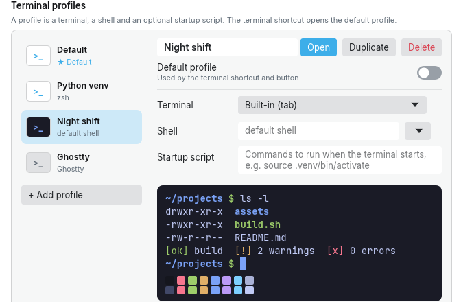</picture></td>
<td><picture><source media="(prefers-color-scheme: dark)" srcset="docs/dark/dev-links.png">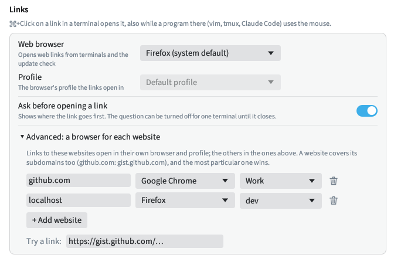</picture></td>
</tr>
<tr>
<td align="center"><sub>Terminal profiles</sub></td>
<td align="center"><sub>A browser and profile for each website</sub></td>
</tr>
<tr>
<td><picture><source media="(prefers-color-scheme: dark)" srcset="docs/dark/dev-theme-editor.png">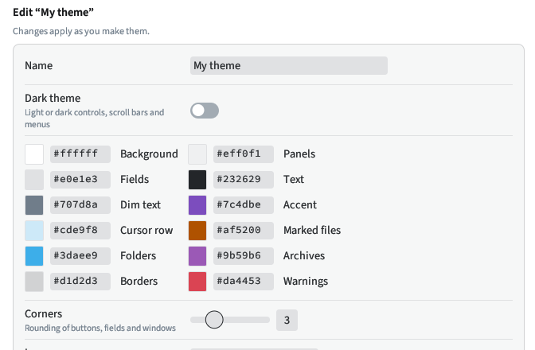</picture></td>
<td><picture><source media="(prefers-color-scheme: dark)" srcset="docs/dark/dev-default-apps.png">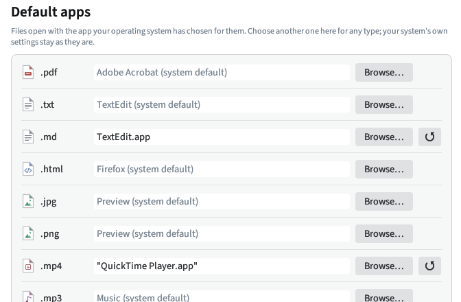</picture></td>
</tr>
<tr>
<td align="center"><sub>Your own theme</sub></td>
<td align="center"><sub>Default apps for each file type</sub></td>
</tr>
<tr>
<td><picture><source media="(prefers-color-scheme: dark)" srcset="docs/dark/dev-shortcuts.png">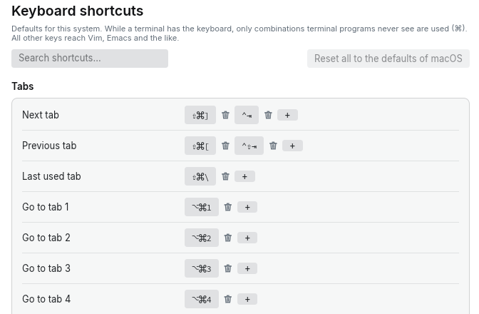</picture></td>
<td><picture><source media="(prefers-color-scheme: dark)" srcset="docs/dark/dev-quick-filters.png">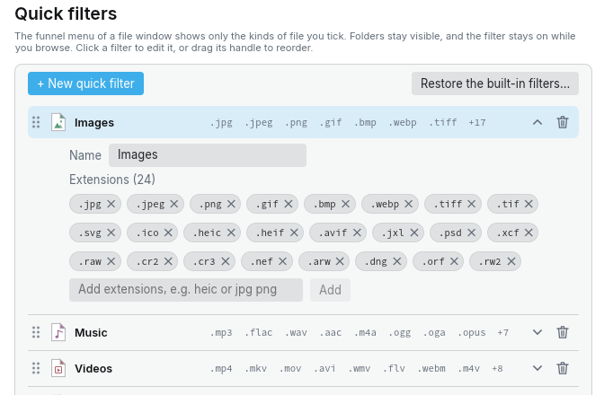</picture></td>
</tr>
<tr>
<td align="center"><sub>Keyboard shortcuts</sub></td>
<td align="center"><sub>Quick filters</sub></td>
</tr>
</table>

<a id="formats"></a>

## Formats in Quick View

Formats in **bold** have something extra, noted in brackets.

| Kind | Formats |
|---|---|
| Tables | **Parquet** (filter rows), **ORC** (schema), **CSV / TSV** (delimiter detected, source view), **Excel** `.xlsx` `.xlsm` `.xlsb` `.xls` and **ODS** (sheet tabs), Arrow / Feather, Avro, JSON Lines |
| Databases | **SQLite** (tables and views, read-only), **DuckDB** (tables, columns and estimated rows, through the `duckdb` tool) |
| Arrays and statistics | **NumPy** `.npy` (any size), **`.npz`** (small arrays as tables), **HDF5** (datasets as tables; newest format only), **MATLAB** `.mat` (variables, struct fields), **NetCDF** (variables, dimensions, units), **R data** `.RData` `.rds` (data frames as tables), **Stata** `.dta`, **SPSS** `.sav`, **SAS** `.sas7bdat` (variables and their labels) |
| Models | **safetensors** (metadata), **GGUF** (quantization types), **PyTorch** `.pt` `.pth` `.ckpt` (the pickle is never run), **ONNX** (inputs, outputs, operators) |
| Notebooks and documents | **Jupyter** (cells and outputs), **PDF** (pages), **Markdown** (rendered or source), **Word** `.docx` (headings, lists, tables), **PowerPoint** `.pptx` (slide by slide), ODF `.odt` `.odp`, RTF, **EPUB** (chapters), **Pages / Keynote / Numbers** (the saved picture), **e-mail** `.eml` `.mbox` (attachments listed, never opened) |
| Code and text | about 60 languages highlighted, **JSON** (tree; copy a value's path), YAML, TOML, logs, **certificates** `.pem` `.crt` (validity, fingerprints; private keys never shown), **calendars** `.ics`, **contacts** `.vcf` and **subtitles** `.srt` `.vtt` (as tables) |
| Images | PNG, **JPEG / TIFF / WebP** (EXIF: camera, exposure, GPS), **GIF / WebP** (animation), BMP, ICO, TGA, QOI, PNM, DDS, OpenEXR, Radiance HDR, SVG, **HEIC / AVIF** (with the system's tools), **camera RAW** CR2 NEF ARW DNG (embedded preview), **PSD / PSB** (merged picture) |
| Audio and video | **MP3, FLAC, WAV, Ogg, Opus, M4A, AAC, AIFF**… (tags, cover), **MP4 / MOV / MKV / WebM / AVI** (duration, codecs, thumbnail) |
| Geometry and 3D | **GeoJSON, WKT / WKB, GPX, KML / KMZ, shapefiles, GeoPackage** (drawn; pan and zoom), **STL / OBJ / glTF** (turn with the mouse) |
| Fonts | **TTF, OTF, TTC, WOFF, WOFF2** (sample sheet) |
| Archives | **zip, 7z, rar, tar.\*** (contents; <kbd>Enter</kbd> goes inside), **comic books** `.cbz` `.cbr` (cover) |
| Anything else | hex dump |

HDF5 files are read in place, which the library can do only for the newest format (h5py with `libver='latest'`, NetCDF-4). Files in the older format, h5py's default, are not previewed.

<a id="screenshots"></a>

## Screenshots

<table>
<tr>
<td><picture><source media="(prefers-color-scheme: dark)" srcset="docs/dark/sql-filter.png">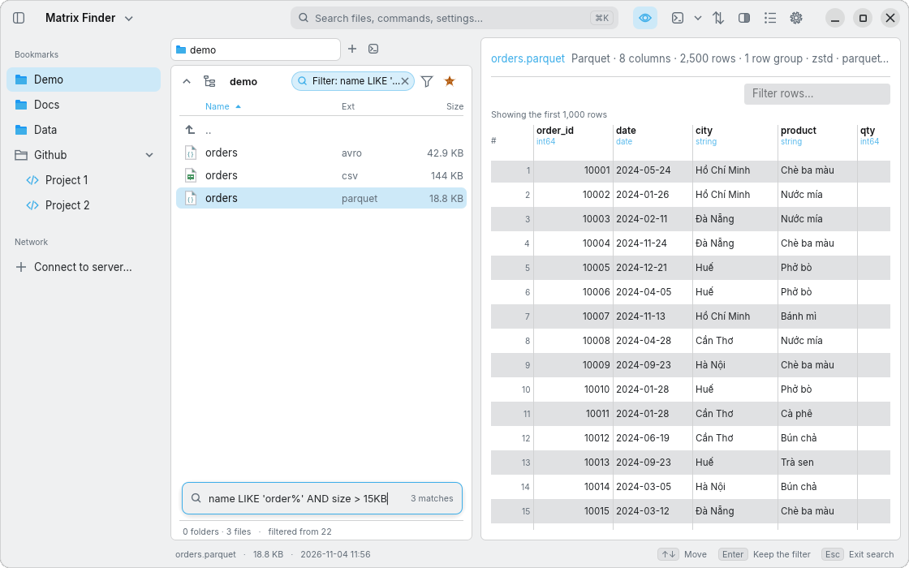</picture></td>
<td><picture><source media="(prefers-color-scheme: dark)" srcset="docs/dark/quickview-safetensors.png">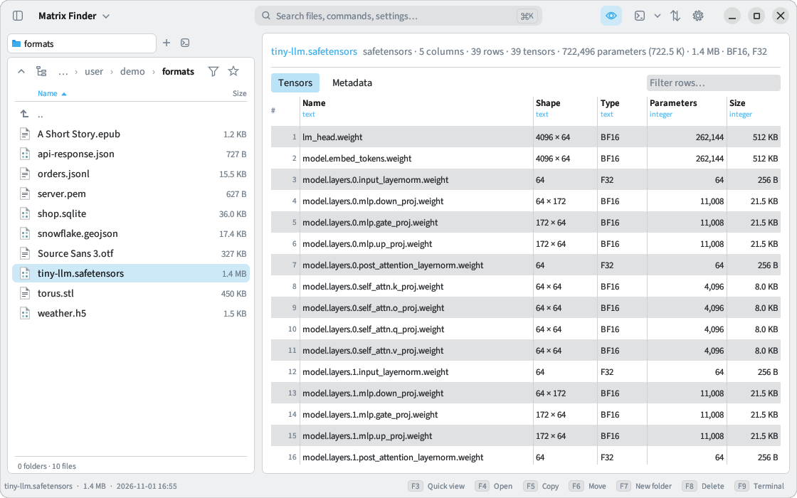</picture></td>
</tr>
<tr>
<td align="center"><sub>A filter typed into the list: <code>name LIKE 'order%' AND size &gt; 15KB</code></sub></td>
<td align="center"><sub>safetensors: every tensor, its shape and size</sub></td>
</tr>
<tr>
<td><picture><source media="(prefers-color-scheme: dark)" srcset="docs/dark/quickview-notebook.png">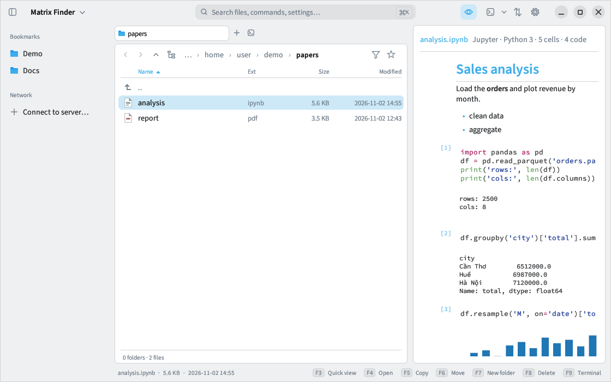</picture></td>
<td><picture><source media="(prefers-color-scheme: dark)" srcset="docs/dark/quickview-sqlite.png">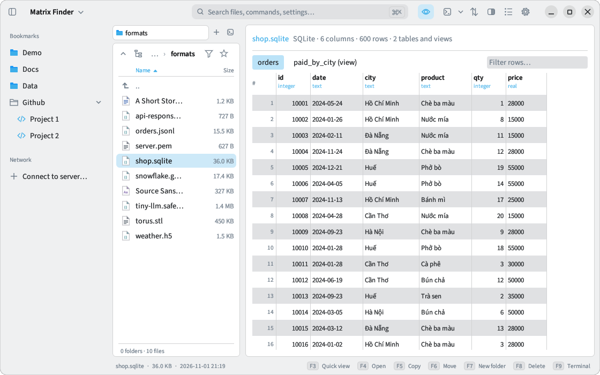</picture></td>
</tr>
<tr>
<td align="center"><sub>Jupyter notebook</sub></td>
<td align="center"><sub>SQLite tables and views</sub></td>
</tr>
<tr>
<td><picture><source media="(prefers-color-scheme: dark)" srcset="docs/dark/table-parquet.png">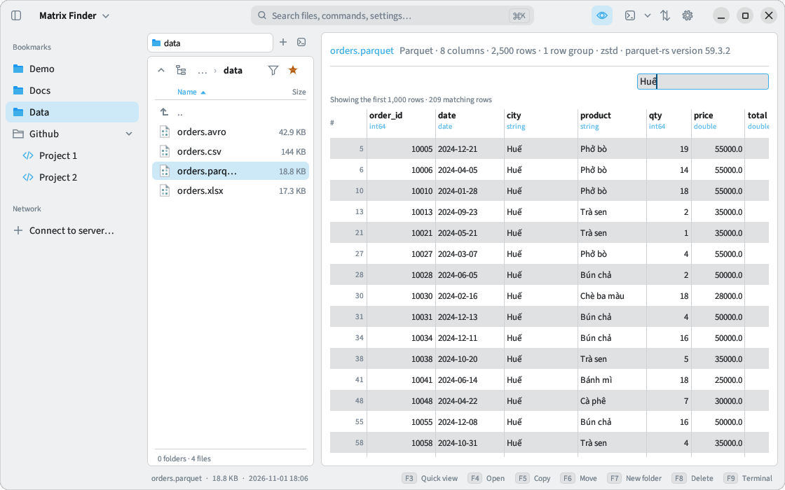</picture></td>
<td><picture><source media="(prefers-color-scheme: dark)" srcset="docs/dark/palette.png">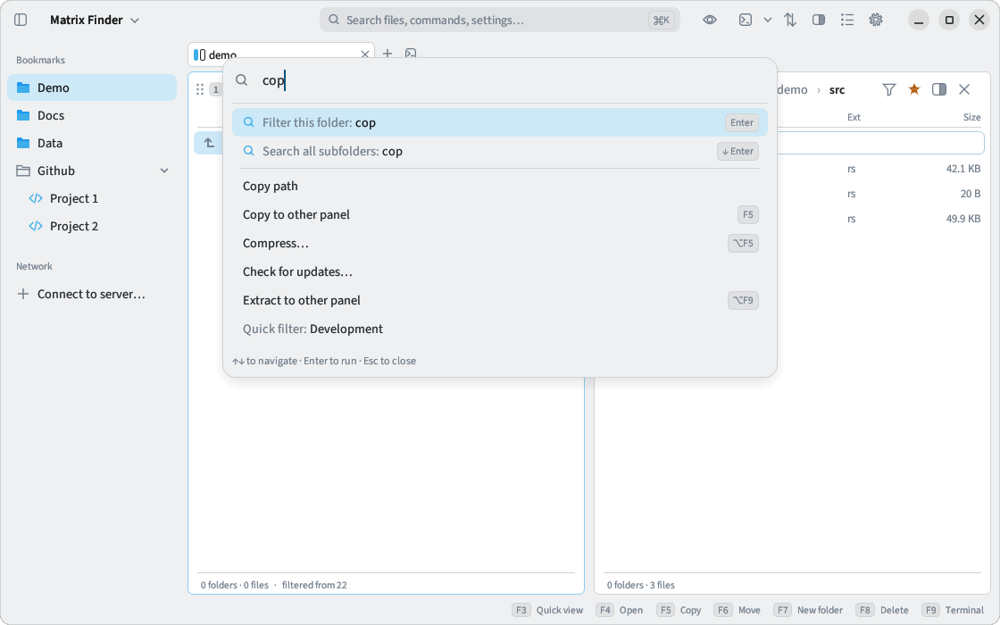</picture></td>
</tr>
<tr>
<td align="center"><sub>Parquet with a row filter</sub></td>
<td align="center"><sub>Command palette</sub></td>
</tr>
</table>

More in [`docs/light`](docs/light) and [`docs/dark`](docs/dark).

<a id="install"></a>

## Install

**macOS (Apple silicon):** download the DMG from the [latest release](https://github.com/quangtiencs/matrix_finder/releases/latest) and drag **Matrix Finder** to **Applications**. It is ad-hoc signed: the first time, right-click the app and choose **Open**.

**Linux (Ubuntu 22.04+, Debian 12+, Fedora):** download the `.deb` or `.rpm` for your machine (amd64/x86_64 or arm64/aarch64) from the [latest release](https://github.com/quangtiencs/matrix_finder/releases/latest) and install it with `sudo apt install ./matrix-finder_<version>-1_amd64.deb` or `sudo dnf install ./matrix-finder-<version>-1.x86_64.rpm`. A copy installed earlier with the script below would keep starting instead: remove it first with the script's `--uninstall`.

**macOS (Intel), other Linux distributions:** the install script installs what it needs (it asks first), builds the newest release and installs it in your home folder. Run it again to upgrade; `--uninstall` removes it. It does not install next to a `.deb` or `.rpm` package.

```bash
curl -fsSL https://raw.githubusercontent.com/quangtiencs/matrix_finder/main/scripts/install.sh | bash
```

**From source** (Rust 1.95+ and a C/C++ compiler; also Windows): `cargo build --release`. See [CONTRIBUTING.md](CONTRIBUTING.md) for the details.

Then `matrix_finder ~/project` opens a folder, a file, an archive or an `sftp://` address; while it runs, a second launch opens a new tab in the same window.

<a id="shortcuts"></a>

## Shortcuts

| Key | Action | Key | Action |
|---|---|---|---|
| *type* | filter this folder (<kbd>Esc</kbd> to leave) | <kbd>Ctrl</kbd>+<kbd>K</kbd> | command palette |
| <kbd>F3</kbd> | Quick View on / off | <kbd>F9</kbd> / <kbd>Ctrl</kbd>+<kbd>`</kbd> | terminal here / terminal tab |
| <kbd>Enter</kbd> | open folder, archive or file | <kbd>Backspace</kbd> | parent folder |
| <kbd>Tab</kbd> | other panel | <kbd>F5</kbd> / <kbd>F6</kbd> | copy / move there |
| <kbd>Ctrl</kbd>+<kbd>F</kbd> | filter, or search all subfolders | <kbd>Ctrl</kbd>+<kbd>L</kbd> | type a path |
| <kbd>Ctrl</kbd>+<kbd>T</kbd> | new tab | <kbd>Ctrl</kbd>+<kbd>Shift</kbd>+<kbd>O</kbd> / <kbd>E</kbd> | split right / down |

macOS uses <kbd>⌘</kbd> instead. <kbd>F1</kbd> lists every key, and *Settings → Keyboard shortcuts* changes any of them. While a terminal has the keyboard, it keeps the keys that terminal programs use.

<details>
<summary><b>Filter syntax</b></summary>

```sql
report                            -- name contains "report"
*.parquet   run_??.log            -- globs
.csv .tsv                         -- by extension
size > 1GB AND age < 7d           -- s, m, h, d, w, mo, y
ext IN ('pt', 'safetensors') AND modified >= '2026-01-01'
name REGEXP '^epoch_\d+\.ckpt$'   -- regular expressions (~ minds case)
source LIKE '%TODO%'              -- a line of the file matches, like grep
```

Fields: `name` `ext` `size` `type` `modified` `age` `hidden` `source`. <kbd>↓</kbd> <kbd>Enter</kbd> in <kbd>Ctrl</kbd>+<kbd>F</kbd> searches every subfolder.

</details>

## Privacy and security

Matrix Finder collects nothing and sends no telemetry. It goes online only when you connect to a server, open a link, or check for updates (off by default; it asks GitHub's public API for the latest release).

Previews read files as data and run no code from them. Files extracted from a downloaded archive keep macOS's quarantine mark, so Gatekeeper still checks them. Server passwords are never saved: one is asked once each time the app starts and kept in memory only. SSH keys or the SSH agent spare you typing it.

<a id="license"></a>

## License

MIT, see [LICENSE](LICENSE). The program includes open source libraries, fonts and icons under their own licenses (MIT, Apache-2.0, BSD, SIL Open Font License and others), listed with their texts in [THIRD-PARTY-LICENSES.md](THIRD-PARTY-LICENSES.md). RAR archives are read with UnRAR, whose freeware license forbids using it to make a RAR-compatible archiver. The AI tool logos come from [LobeHub Icons](https://github.com/lobehub/lobe-icons) (MIT) and are trademarks of their owners; the file icons from [Material Icon Theme](https://github.com/material-extensions/vscode-material-icon-theme) and [Fluent UI System Icons](https://github.com/microsoft/fluentui-system-icons) (MIT).

<div align="center">
<br>

<br>
<sub>Made with 🦀 Rust and egui · An independent project, not affiliated with <i>The Matrix</i> films or their owners.</sub>
</div>
